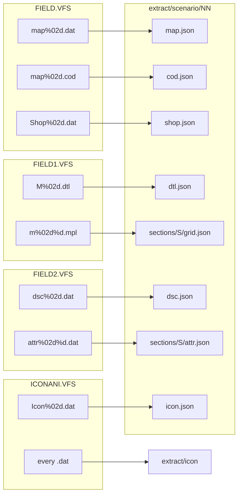

# File formats

Part of the [FDPS notes](README.md). Decompiled functions are Ghidra output, not original source. Nothing here was checked by running the game.

This is how the bytes are laid out. How a frame is drawn is in [Pictures](pictures.md). How a visit uses a scenario is in [Scenario files](scenario.md). How a tile is queried is in [Map](map.md). How a string is drawn is in [Text](text.md). Packed members are the directory in [Archives](archives.md): magic `VFS`, version `uint16` 1 at `+3`, directory offset `uint16` `0x23` at `+5`, member count `uint32` at `+7`. Each entry is 26 bytes: a 13-byte name, `uint32` size at `+13`, a second `uint32` at `+17` that equals the size on every member checked, one zero byte, and the file offset `uint32` at `+22`. `object 1 + 0x29820` reads that directory.

## Sprites

Two picture containers. Both store palette indexes, not RGB. A palette file is 768 bytes, 256 triples, each component 0 through 63. `Fde.pal` colors the map and the interface. `Fight.pal` colors the fight. `object 1 + 0x12f10` writes those bytes to the DAC.

### CEL

Map sprites, portraits, section tiles, and the interface windows. The header is `CEL`, version byte `0x01`. On every file checked, byte 6 is 0 and byte 8 is 0 or 1. `object 1 + 0x1d930` takes the width from the little-endian short at `+7` and the height from the little-endian short at `+9`. That width is byte 7 plus 256 times byte 8, so a section tile is 24×24 and `VILLAGE.CEL` is 320×200. The directory offset is the big-endian short at `+4`, and it is `0x0f` on every file checked, including all 69 section files in `FIELD1.VFS`. The little-endian dwords there are picture offsets. Picture `i` is the bytes from dword `i` to dword `i+1`. The uint16 at `+10` is the picture count for the `.cel` members of `MISC.VFS` and for `FACE.CEL`. On `ICON.CEL` that field is 128, and the ordered directory holds 1920 pictures.

A picture is a signed column count, a signed row count, and then that many cell indexes. None of the fight pictures has a negative count. Each cell is a compressed stream. Mode 0 of `object 1 + 0x4664b` is the decoder that writes the stored indexes. The opcodes are in [Pictures](pictures.md).

`ICON.CEL` gives character `id` pictures `id * 12` through `id * 12 + 11`. `object 1 + 0x13020` reads the directory at `0x0f`. The 1921 dwords run through index 1920, where the dword equals the file size, so ids 0 through 159 each have 12 frames. A frame expands to 24×24. `FACE.CEL` is one 125×100 picture per id, 160 pictures. Section tiles are the same container, one picture per `ATTR` record on 68 of the 69 section files. `M310.CEL` is the exception named in [Map](map.md).

### SAF

Fight clips, spell clips, backdrops, icon clips, and the three members of `BaseAni.vfs` (`EasyAni.saf`, `Explo.saf`, `Turn.saf`). Version byte `0x06`. `object 1 + 0x40e0` returns one frame and `object 1 + 0x44d0` returns the count.

| Offset | Field |
| --- | --- |
| 0 | `SAF` |
| 3 | version `0x06` |
| `+7`, `+9` | `uint16` cell width and height. 24 and 24 on `STAND000.SAF`. |
| `+0x0c` | `uint16` frame count |
| `+0x0e` | `uint32` offset of the frame-offset table, `count` dwords |
| `+0x16` | `uint16` limit on a chunk's picture index |
| `+0x18` | `uint32` offset of that picture table |
| `+0x20` | `uint16` limit on a cell index |
| `+0x22` | `uint32` offset of the compressed-cell table |
| `+0x2a` | `uint16` sample count |
| `+0x2c` | `uint32` offset of the sample-offset table |

Frame `i` is the record at `file + dword[table + i*4]`. Inside it: `int16` sample index at `+0`, `int16` hold at `+2`, a preamble byte at `+4`, a hit byte at `+5`, and the chunk count `int16` at `+8`. Chunks start at `+10` and are 13 bytes: picture `uint16`, x `int16`, y `int16`, a mode byte, an `int16`, and four trailing bytes that are 0 on the fight and effect clips. A picture in the picture table is the column count, the row count, and the cell indexes. A cell in the cell table is the compressed stream mode 0 expands. The same layout covers `FIGHT.VFS`, `FIGACT.VFS`, `BACKGRND.VFS`, the effect members of `MISC.VFS`, and the 67 `ICON####.SAF` members of `ICONANI.VFS`.

## Scenario data

`object 1 + 0x127b0` formats these names with `object 2 + 0x9cf4`. The grid each index loads is in [Scenario files](scenario.md).

One scenario index names these files. `map%02d.dat`, `map%02d.cod`, `Shop%02d.dat`, and `fdetxt%02d.txt` (the index plus 1) come from `FIELD.VFS`. `dsc%02d.dat` comes from `FIELD2.VFS`. `M%02d.dtl` comes from `FIELD1.VFS`. Each section of the `DSC` file then names `m%02d%d.mpl`, `m%02d%d.cel`, and `attr%02d%d.dat`. What a visit does with them is in [Scenario files](scenario.md). The archives are in [Archives](archives.md).

A content pack is `extract/scenario/NN/` for indexes 0 through 64, except 30. `NN` is the index as two digits. `S` is the section, taken from the `DSC` count, or 0 when that file is absent. `SHOPNN.DAT` and `ICONNN.DAT` exist for indexes 0 through 29. Every `.dat` member of `ICONANI.VFS` is also written under `extract/icon/`. `scripts/extract_scenario_records.py` is that walk. The JSON keys are the structs below.



The records below are packed. The comment on a field is its file offset.

```
struct MapTurn {                 /* sixteen of these at MAP + 3 */
    uint8_t turn;                /* matches object 2 + 0x9ce8 */
    uint8_t handler;             /* index into object 2 + 0x1c4 */
    uint8_t side;                /* matches the argument of object 1 + 0x1de50 */
};

struct MapStep {                 /* sixteen of these at MAP + 0x33 */
    uint8_t handler;             /* stored when the second byte matches */
    uint8_t match;               /* the step's third argument */
};

struct MapFind {                 /* sixteen of these at MAP + 0x53. One per DTL value */
    uint8_t kind;                /* 0 gives the item, 1 adds the short, any other calls a handler */
    int16_t value;               /* item id, or the amount added to object 2 + 0x43b8 */
};

struct MapActor {                /* 26 bytes. The array starts at MAP + 0x83 */
    uint8_t side;                /* +0  -> unit +6 */
    uint8_t character;           /* +1  -> unit +7 and +8. The COD id of this record */
    uint8_t at_2;                /* +2  not loaded. 0 in all 1676 records */
    uint8_t at_3;                /* +3  not loaded. 0 except fourteen records of map 18 */
    uint8_t scale;               /* +4  the multiplier in Units */
    uint8_t item0;               /* +5  first equipped id. 0xff makes the next byte the first pair */
    uint8_t item1;               /* +6 */
    uint8_t item[6];             /* +7  0xff sets the empty flag */
    uint8_t spell[4];            /* +0x0d -> unit +0x1a */
    uint8_t phase;               /* +0x11 -> unit +0x34 */
    uint8_t arg0;                /* +0x12 -> unit +0x35 */
    uint8_t arg1;                /* +0x13 -> unit +0x36 */
    uint8_t script;              /* +0x14 -> unit +0x3d. Script 5 reads it */
    uint8_t group;               /* +0x15 compared by object 1 + 0x13800. 0xff in 18 records */
    uint8_t end[3];              /* +0x16 -> unit +0x31. Copied when the pool is below 1 */
    uint8_t learned;             /* +0x19 -> unit +0x1e */
};

struct MapFile {                 /* FIELD.VFS. Length is 0x83 + actor_count * 26, except MAP31.DAT */
    uint8_t zero;                /* +0  0 in every file */
    uint8_t slots;               /* +1  how many unit slots are allocated */
    uint8_t actor_count;         /* +2 */
    MapTurn turn[16];            /* +3 */
    MapStep step[16];            /* +0x33. DTL value n selects the pair at file + 0x31 + n * 2 */
    MapFind find[16];            /* +0x53 */
    MapActor actor[];            /* +0x83 */
};

struct CodRecord {               /* at file + 9, then every 6 bytes */
    int16_t id;                  /* equals the actor's character byte. 0 on a reinforcement record */
    int16_t x;                   /* placement reads this, at file + 0x0b + index * 6 */
    int16_t y;
};

struct CodFile {                 /* FIELD.VFS. Length is 9 + count * 6 */
    char magic[3];               /* COD */
    uint8_t zero;                /* +3  0 in all 63 files */
    uint8_t flag;                /* +4  1 in 31 files, 16 in 32. Placement does not read it */
    uint8_t at_5;                /* +5  9 in all 63 files */
    uint8_t zero2;               /* +6  0 */
    uint16_t count;              /* +7  equals MapFile.slots + MapFile.actor_count. Placement does not read it */
    CodRecord record[];
};

struct ShopFile {                /* FIELD.VFS. 36 bytes, SHOP00 through SHOP29 */
    uint8_t group[3][12];        /* an id, ended by 0xff or by the twelfth byte */
};
```

`object 1 + 0x21470` reads one group of `ShopFile`. The price it charges is the item struct in [Units](units.md).

`Icon00.dat` through `Icon29.dat`, the `Win` scripts, and `GoodEnd.dat` are in `ICONANI.VFS`. A script is a byte stream. Opcode 0 ends it. There is no header. The opcodes and the lengths that walk every `.dat` member of that archive are in [Scenario files](scenario.md).

The character, enemy, class, spell, rank, and item rows are members of `MISC.VFS`. The structs, the strides, and which function indexes each one are in [Units](units.md). A field marked unread is copied with no role added. The stat tables are not written again.

## Map data

One scenario index names a `DSC` file, and each section of that file names an `MPL`, a `CEL`, and an `ATTR` file. `M%02d.dtl` is a separate byte per tile. These records are packed the same way.

```
struct Section {                 /* eight dwords. DSC00 is count 1, then 0, 0, 8, 8, 0, 0, 9, 1 */
    int32_t offset_x;            /* +0  added into the camera. 0 in all 66 sections */
    int32_t offset_y;            /* +4  0 in all 66 */
    int32_t scale_x;             /* +8  8 on the ground and the foreground. 4 or 8 on the three order-8 plates */
    int32_t scale_y;             /* +0x0c  8, or 2 or 4 on those three */
    int32_t drift_x;             /* +0x10 added to the offset when the tick changes. 0 in all 66 */
    int32_t drift_y;             /* +0x14  0 in all 66 */
    int32_t order;               /* +0x18 the low byte is when the plate is painted */
    int32_t highlight;           /* +0x1c the low byte selects the range tint */
};

struct DscFile {                 /* FIELD2.VFS. 4 + count * 32 bytes */
    uint32_t count;
    Section section[];
};

struct MplFile {                 /* FIELD1.VFS. Length is 11 + width * height * 2 */
    char magic[3];               /* MPL */
    uint8_t at_3;                /* not read */
    uint8_t version;             /* +4  1 in all 68 files */
    uint16_t at_5;               /* +5  11 in all 68 files */
    uint16_t width;              /* +7 */
    uint16_t height;             /* +9 */
    int16_t cell[];              /* +0x0b  file + 0x0b + (y * width + x) * 2 */
};

struct Attr {                    /* 4 bytes at ATTR + 0x11 + picture * 4 */
    uint8_t anim;                /* low 3 bits are the kind. Bits 0x60 are the tile search. Bit 0x80 selects the tint */
    uint8_t tint;                /* passed to the expander when anim bit 0x80 is set */
    uint8_t terrain;             /* 0, 1, 2, 5, or 6 on disk */
    uint8_t backdrop;            /* combat loads Back%02d.saf, after decrementing when this is nonzero */
};

struct AttrFile {                /* FIELD2.VFS. Count is (length - 0x11) / 4 */
    char magic[3];               /* ATR */
    uint8_t at_3;                /* not read */
    uint8_t version;             /* +4  1 in all 69 files */
    uint16_t at_5;               /* +5  13 in all 69 files */
    uint8_t pad[0x11 - 7];       /* +7  not read */
    Attr record[];
};

struct DtlFile {                 /* FIELD1.VFS. 63 files are 16 + width * height */
    char magic[3];               /* DTL */
    uint8_t at_3;                /* not read */
    uint8_t version;             /* +4  1 in all 64 files */
    uint16_t at_5;               /* +5  14 in all 64 files */
    uint16_t width;              /* +7 */
    uint16_t height;             /* +9 */
    uint8_t pad[0x10 - 11];      /* +0x0b  not read */
    uint8_t tile[];              /* +0x10  one byte per tile */
};
```

`M%02d%d.CEL` is the tile sheet for that section. The container is the `CEL` layout above. The big-endian short at `+4` is `0x0f` on all 69 section files. `object 1 + 0x1c0c0` reads `MplFile.cell`. `object 1 + 0x1b790` reads one `Attr` and one `DtlFile` byte. The order and highlight bytes, and the two files whose record counts do not match, are in [Map](map.md). `M31.DTL` is 51 by 64 and 6545 bytes. The bytes past the first `51 * 64` were not read.

## Strings

`FDETXT##.TXT`, in `FIELD.VFS`. All 66 files use one layout. `object 1 + 0x19630` loads `FDETXT00.TXT` as the interface block. `object 1 + 0x127b0` and `object 1 + 0x20f80` load `FDETXT(index + 1).TXT` for the scenario.

```
count = first_u16 / 2
offset[i] = u16 at byte i*2
glyphs of string i = the u16s from offset[i] up to offset[i+1], or to EOF for the last
```

The offsets are nondecreasing and every span is even, so the strings tile the tail of the file. Every string ends with `0xffff`. The other words are either a cell index or one of the eight controls in [Text](text.md). A cell index is not a character code.

`FDETXT.FON` is 57344 bytes, 1792 cells of 32. Cell `n` is `font + n * 0x20`. A cell is 16 rows of two bytes. `object 1 + 0xfea0` takes the high bit of a byte as the leftmost pixel and shifts left for the next pixel. A set bit writes the palette index. A clear bit leaves the pixel already there. Cells 0 through 9 are the digits and cells 10 through 35 are `A` through `Z`. The reading of the other cells is `extract/text/glyph-map.tsv`. The notes do not carry the strings.

## Sound

Sampled effects are RIFF `WAVE` files. Each one checked has a `fmt ` chunk of audio format 1, one channel, 8 bits, and a `data` chunk of that many bytes. The bytes sit around `0x80`. `BaseWav.vfs` is a `VFS` member of `MISC.VFS` with nine members, all 11025 Hz: `Beep.wav`, `Chess.wav`, `Equip.wav`, `Incom.wav`, `Miss.wav`, `OpWin.wav`, `OpWin1.wav`, `Rest.wav`, and `Sure.wav`. Three further waves sit directly in `MISC.VFS`. `Bonus.wav` and `EarQu.wav` are 11025 Hz. `Levup.wav` is 22050 Hz. Some of these files also carry `fact`, `LIST`, and `cue ` chunks after `data`. `object 1 + 0x20790` starts one. The calls that were read pass the wave, 1, −1, and −1.

A `SAF` sample is not a `WAVE` file. The record at `file + dword[sample_table + index * 4]` is two flag bytes, a `uint16` rate, a `uint32` length, and that many bytes at `+8`. On the one sample in `ACT000.SAF` the `uint16` is 11025 and the length is 4464. `01 08` selects 0, `01 10` selects 1, `02 08` selects 2, and any other pair selects 3. Inferred from those pairs: the first byte is the channel count and the second byte is the sample width, so selector 0 is one channel of 8-bit samples. The call order and the Miles names are in [Pictures](pictures.md).

`scripts/extract_sounds.py` is that walk. It copies each `.wav` member as stored, and writes each sample as a format-1 WAVE at the rate in the record. A walk of the local archives wrote 12 waves and 600 samples across 281 clips. Every sample was `01 08`. The bytes sit around 128, the center of an unsigned 8-bit sample, and a format-1 WAVE stores 8-bit samples that way. 483 are 11025 Hz and 117 are 22050 Hz. The files are `extract/sounds/waves/`, `extract/sounds/samples/`, and `extract/sounds/sounds.json`. `sounds.json` names the frames that point at each sample.

`BaseAni.vfs` is the other nested archive in `MISC.VFS`. Its three members are `SAF` clips, not waves.

Music is a CD audio track. The recording is not in the executable or the archives. No `FORM`/`XMID` sequence and no `MThd` header is in those files. The sixty bytes in [Turns](turns.md) are track numbers. `object 1 + 0x20a30` calls `object 1 + 0x2c5cb` with the byte plus 1, and that plus 1 is the track the drive is asked for. The title's request of 1 asks for track 2. The table's bytes run from 1 to 18, so the drive is asked for tracks 2 through 19.

`object 1 + 0x2c3a6` was disassembled. It calls `object 1 + 0x32fd8` with interrupt `0x2f`. The register block at `object 2 + 0x9dc8` has `AX` = `0x1500` and `EBX` = 0. The returned `BX` is stored at `object 2 + 0x9dfc` and the returned `CL` at `object 2 + 0x9dfe`. A `BX` of 0 returns 0. Otherwise, when `object 2 + 0x9e54` is 0, `object 1 + 0x2b84e` allocates two real-mode blocks of `0x20` paragraphs through interrupt `0x31` with `AX` = `0x0100`. The first segment, shifted left by 4, is the request block at `object 2 + 0x9de8`. The second is the data block at `object 2 + 0x9da4`, and its segment in the high word is the transfer address at `object 2 + 0x9da8`. It then reads the disc. The status word at request offset 3 is compared with `0x810c`. That value returns 2. Any other value returns 1. The startup compare against 1 does not branch, in [Session](session.md).

`object 1 + 0x3332c` copies its count from the second pointer onto the first. The request is copied into the real-mode block, and the driver's result is copied back. `object 1 + 0x2b8ed` fills a real-mode register block: `EAX` = `0x1510`, `EBX` = 0, `ECX` = the drive byte at `object 2 + 0x9dfe`, and `ES` = the request segment. It then calls `object 1 + 0x333c7` with interrupt `0x31`, `AX` = `0x0300`, and `BL` = `0x2f`. The stub at `object 1 + 0x3e129` is `int 0x31`, and the stub at `object 1 + 0x3e123` is `int 0x2f`. A nonzero carry dword at `object 2 + 0x9dc4` prints the string at `object 2 + 0x223c`. Inferred: `AX` = `0x0300` asks the extender to run real-mode interrupt `0x2f`, and `AX` = `0x1510` hands the request to the CD-ROM driver for that drive.

The requests that were read:

| Call | Length | Command | What the bytes do |
| --- | --- | --- | --- |
| `object 1 + 0x2bd15` | `0x1a` | 3 | Control byte `0x0a`, 7 data bytes. Byte 1 is stored at `object 2 + 0x9e06`, byte 2 at `object 2 + 0x9e07`, and the dword at byte 3 becomes the end position at `object 2 + 0x9e0b`. |
| `object 1 + 0x2be38` | `0x1a` | 3 | Control byte `0x0b`. Byte 1 is the track. The dword at byte 2 becomes the position at `object 2 + 0x9e01`. Byte 6 is masked with `0xd0` and stored at `object 2 + 0x9e05`. |
| `object 1 + 0x2c1c2` | `0x16` | `0x84` | Byte `0x0d` is 0. The dword at `+0x0e` is the start position. The dword at `+0x12` is the end minus the start. |
| `object 1 + 0x2c217` | `0x0d` | `0x85` | No data bytes. |
| `object 1 + 0x2c0bf` | `0x1a` | 3 | Control byte 6, 5 data bytes. The dword at byte 1 is stored at `object 2 + 0x9e1c`. |

Inferred from those command bytes and from the arithmetic below: command 3 is an input control, `0x0a` is the disc's first track, last track, and lead-out, `0x0b` is one track's start, `0x84` plays audio, and `0x85` stops it. Byte `0x0d` of the play request is the addressing mode, and 0 selects a sector number. `object 1 + 0x2b9af` splits the returned dword into its low, middle, and high bytes, and `object 1 + 0x2b9e8` folds them:

```
position = hi * 4500 + mid * 75 + lo - 0x96    # object 1 + 0x2b9e8
```

Inferred: the three bytes are a disc time, frame then second then minute, and the result is the sector address the play request stores. 75 is the frame count of one second, 4500 is one minute, and `0x96` is the 150-frame lead-in.

`object 1 + 0x2c573` was disassembled. The position just read is the start. When the track plus 1 is greater than the byte at `object 2 + 0x9e07`, the end is the dword at `object 2 + 0x9e0b`. Otherwise it asks for the next track and uses that position as the end, then asks for the original track again. `object 1 + 0x2c5cb` stops, asks for the track, takes that span, and plays it. One track is the sectors from its start up to the next track's start, or up to the lead-out when it is the last.

`object 1 + 0x2c458` calls the device-status request and returns 1 when bit 9 of the status word at `object 2 + 0x9e20` is clear. The 75-tick caller in [Turns](turns.md) plays the track again when that return is nonzero. Inferred: bit 9 is the busy bit, so a track that has finished is started again. `object 1 + 0x2c681` returns 1 when the masked byte at `object 2 + 0x9e05` is not `0x40`. No direct call of it was found. Inferred: `0x40` marks a data track.

Four more requests have no direct call. `object 1 + 0x2c656` stops, asks for track 1 and for the disc, and plays from sector 0 to the lead-out. `object 1 + 0x2c602` plays from one track's position to another's and returns the sector count. `object 1 + 0x2c469` sends control byte 9 and returns the following byte. `object 1 + 0x2c42c` sends output command `0x0c` with data byte 5, then returns the same not-busy test as `object 1 + 0x2c458`.

`{prefix}\Pack.vfs` is named in `object 1 + 0x20a30`, and that call is not entered, in [Turns](turns.md). The intro path names `FD1.Aud` beside `fd.exe` and `FD1.Vid`. Those files were not among the data files. A walk of the archives found no `AVI`, Smacker, `FLI`, or `MPEG` member. The clips the engine plays as a movie are `SAF` files, extracted in [Pictures](pictures.md). `Icon%04d.wav` is the name icon opcode 8 formats. No member of that name is in `ICONANI.VFS` or `BaseWav.vfs`.
